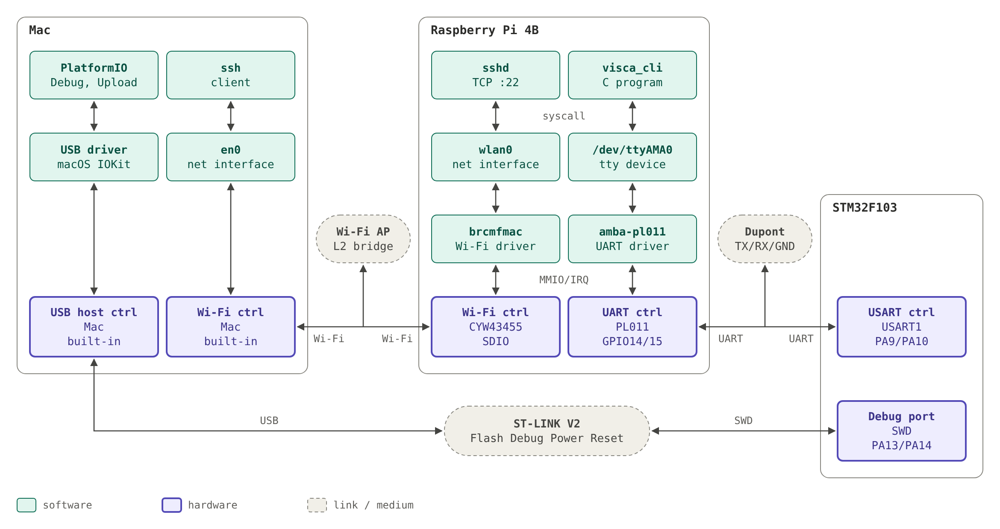
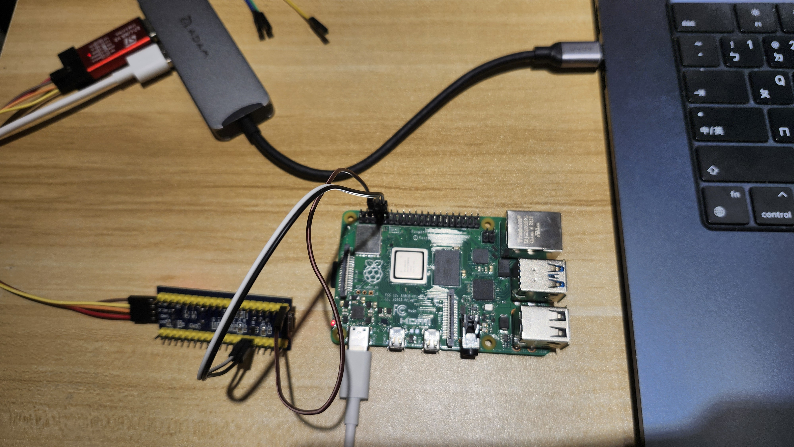

### System Diargram 

### System settings
Primary UART interface: /dev/serial0 -> /dev/ttyAMA0 
Secondary UART interface: N/A

### Controller & Device nodes
UART: 1. PL011:
         - UART0 -> /dev/ttyAMA0
         - UART2～5 -> N/A
      2. miniUART:
         - UART1 -> /dev/ttyS0

### Picture   

### Docs
1. Definetion of Primary and Secondary UART Interface: 
https://www.raspberrypi.com/documentation/computers/configuration.html#primary-and-secondary-uart

2. Relationship between UART controller and UART interfaces:
https://www.raspberrypi.com/documentation/computers/configuration.html#prerequisite-information  
